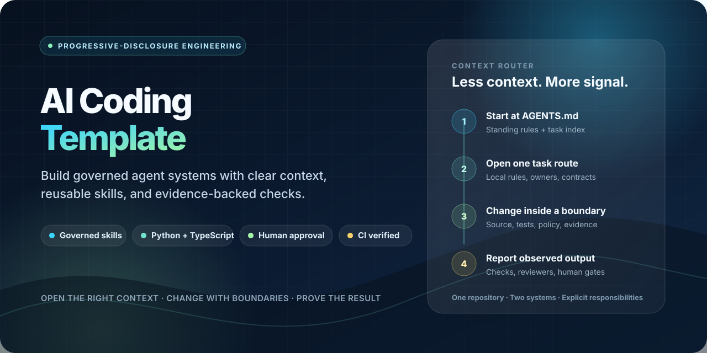
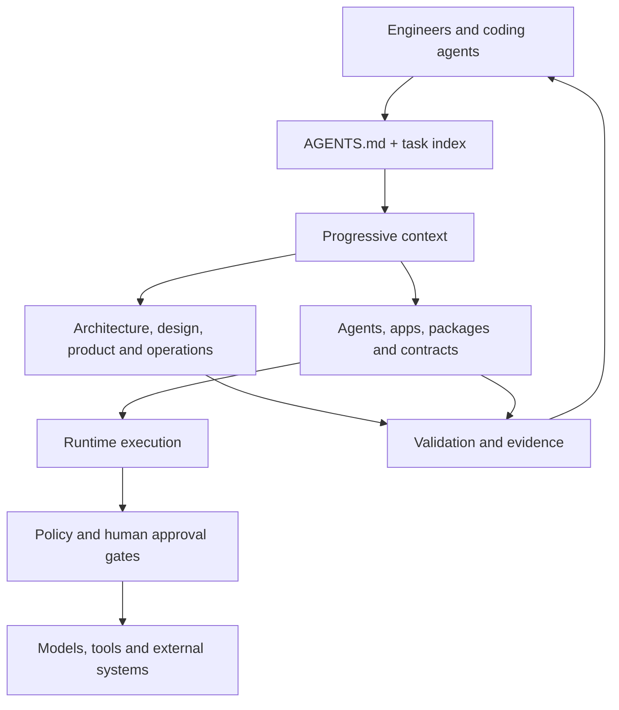

# AI Coding Template

**English** | [简体中文](README.zh.md)



[](https://github.com/Yzdyx/AI-Coding-Template/actions/workflows/pull-request.yml)
[](package.json)
[](package.json)
[](package.json)
[](https://github.com/Yzdyx/AI-Coding-Template/generate)
[](package.json)

**A governed monorepo starting point for coding agents and enterprise agent
applications.** It combines short root instructions, progressive-disclosure
documentation, reusable engineering skills, Python and TypeScript reference
implementations, explicit human approval gates, and repository checks.

[**Use this template**](https://github.com/Yzdyx/AI-Coding-Template/generate)
· [**Explore the documentation**](docs/index.md)
· [**Inspect every path**](docs/repository-map.md)
· [**Read the security policy**](SECURITY.md)

The internal workspace name is `enterprise-agent-platform`. This repository is
a reference implementation and an engineering template, not a complete
production service.

## Why this template

| Principle | What it gives you |
| --- | --- |
| **Progressive context** | Agents read a short entry point, choose a task route, and open only the module rules and source files needed for the current change. |
| **Governed runtime patterns** | Agent manifests, shared contracts, policy decisions, checkpoints, telemetry, and approval gates make high-risk behavior explicit. |
| **Evidence over claims** | Deterministic checks, contract tests, workflow gates, execution plans, and review templates keep completion claims tied to observable output. |
| **One repository, clear boundaries** | Coding-agent guidance and runtime agent applications share a repository without sharing responsibilities. |

## Architecture at a glance



`AGENTS.md` governs how coding agents work in the repository.
`agents/<name>/agent.yaml` defines a business agent that may run in production.
Keep those responsibilities separate.

## Use the template

1. Select **Use this template** and create your repository.
2. Replace the template owner, sample agents, environments, baseline values,
   and repository metadata with values that fit your project.
3. Read [AGENTS.md](AGENTS.md), then open the task-specific entry in
   [docs/index.md](docs/index.md).
4. Run the baseline checks before and after your first change.

```powershell
python scripts/check-architecture.py
python scripts/check-agent-manifests.py
python scripts/check-doc-links.py
python .agents/skills/verify-change/scripts/verify.py --root .

pnpm install --frozen-lockfile
pnpm -r typecheck
pnpm -r lint
pnpm -r test
```

The Python repository checks use Python 3.10+ and the standard library. The
TypeScript workspace requires Node.js 22+ and pnpm 9.12.0. For the optional
local container stack, follow [local development](tooling/local-dev/README.md).

## Find your next step

| Task | Start here |
| --- | --- |
| Work on the repository with a coding agent | [Repository instructions](AGENTS.md) |
| Choose the right engineering knowledge | [Knowledge index](docs/index.md) |
| Understand any directory or file | [Complete repository catalog](docs/repository-map.md) |
| Change system boundaries or dependencies | [Architecture](ARCHITECTURE.md) and [dependency rules](docs/architecture/dependency-rules.md) |
| Change a runtime agent | [Research agent](agents/research-agent/AGENTS.md) or [support agent](agents/support-agent/AGENTS.md) |
| Work on an application or package | [Applications catalog](docs/repository-map.md#applications) or [shared packages catalog](docs/repository-map.md#shared-packages) |
| Plan a cross-module change | [Planning guide](docs/PLANS.md) |
| Investigate an incident | [Operations index](docs/operations/index.md) |

## Repository map

| Area | Owns | Detailed inventory |
| --- | --- | --- |
| `.agents/`, `.codex/`, `.github/` | Engineering skills, coding-agent configuration, reviews, issue forms, and CI | [Coding tools](docs/repository-map.md#coding-tools) |
| `docs/` | Architecture, design, product, plans, security, and operations knowledge | [Documentation](docs/repository-map.md#documentation) |
| `agents/` | Research and support agent logic, prompts, tools, workflows, and tests | [Business agents](docs/repository-map.md#business-agents) |
| `apps/` | Admin console, HTTP API, and background worker | [Applications](docs/repository-map.md#applications) |
| `packages/` | Contracts, providers, policy, persistence, telemetry, and evaluation helpers | [Shared packages](docs/repository-map.md#shared-packages) |
| `schemas/` | Manifest, event, and tool JSON contracts | [Schemas](docs/repository-map.md#schemas) |
| `evals/` | Datasets, regression suites, safety cases, and example baselines | [Evaluation](docs/repository-map.md#evaluation) |
| `infra/` | Terraform compositions and authorization policies | [Infrastructure](docs/repository-map.md#infrastructure) |
| `scripts/`, `tests/`, `tooling/` | Repository gates, contract and offline tests, and local tools | [Validation and local tools](docs/repository-map.md#validation-and-local-tools) |

## Engineering contract

- Dependencies point one way:
  `Types → Config → Repo → Service → Runtime → UI`.
- Cross-package access uses public interfaces. Cross-cutting capabilities enter
  through explicit Provider interfaces.
- Cross-module changes start with an execution plan and list the affected
  contracts.
- High-risk and irreversible actions require a human approval node.
- A check must run before it is reported as passing. Skipped checks are not
  passes.
- New, moved, or removed publishable paths update the repository catalog and
  the nearest navigation entry in the same change.

See [AGENTS.md](AGENTS.md) for the working contract and [ARCHITECTURE.md](ARCHITECTURE.md)
for the system model.

## Community and support

| Need | Route |
| --- | --- |
| Ask a usage or setup question | [Support](SUPPORT.md) |
| Propose a change or report a non-security defect | [Open an issue](https://github.com/Yzdyx/AI-Coding-Template/issues/new/choose) |
| Contribute code or documentation | [Contributing guide](CONTRIBUTING.md) |
| Review expected collaboration behavior | [Code of conduct](CODE_OF_CONDUCT.md) |
| Report a vulnerability | [Security policy](SECURITY.md) |

## Template boundaries

- Reference providers include offline and in-memory implementations. They do
  not establish production durability, production authentication, or deployed
  acceptance.
- Infrastructure environments, evaluation baselines, ownership handles, and
  historical execution plans are examples that require project-specific review.
- [Database schema documentation](docs/generated/db-schema.md) is currently a
  template; its planned generator is not implemented.
- The workspace declares `UNLICENSED`. No open-source license grant is included.
  Choose a license deliberately before distributing or accepting external
  contributions.

Start with the smallest structure that fits your risk and deployment needs. A
small team can begin with instructions, documentation, and engineering skills,
then adopt runtime and infrastructure areas as required.
