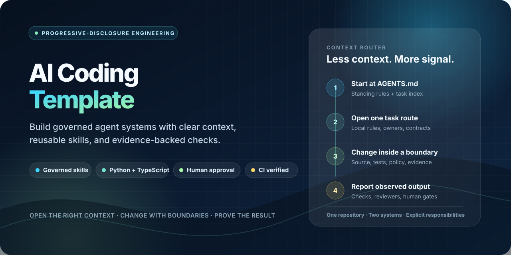
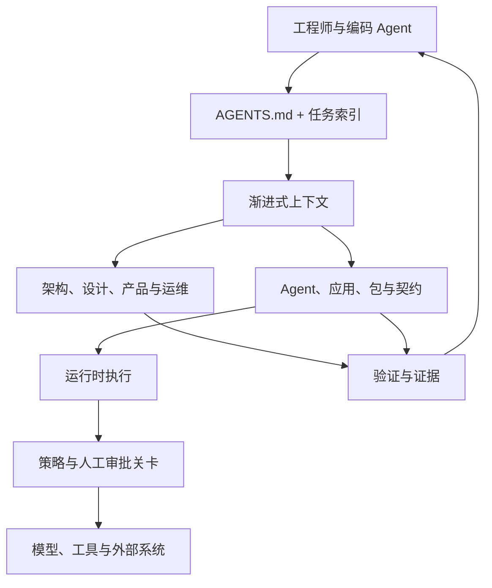

# AI Coding Template

[English](README.md) | **简体中文**



[](https://github.com/Yzdyx/AI-Coding-Template/actions/workflows/pull-request.yml)
[](package.json)
[](package.json)
[](package.json)
[](https://github.com/Yzdyx/AI-Coding-Template/generate)
[](package.json)

**面向编码 Agent 和企业级 Agent 应用的受治理单仓库模板。** 它把简短的根指令、
渐进式披露文档、可复用工程技能、Python 与 TypeScript 参考实现、显式人工审批关卡
和仓库检查组合在一起。

[**使用此模板**](https://github.com/Yzdyx/AI-Coding-Template/generate)
· [**浏览文档**](docs/index.md)
· [**查看全部路径**](docs/repository-map.md)
· [**阅读安全策略**](SECURITY.md)

内部工作区名称为 `enterprise-agent-platform`。本仓库是参考实现和工程模板，
尚不是完整的生产服务。

## 为什么使用此模板

| 原则 | 提供的能力 |
| --- | --- |
| **渐进式上下文** | Agent 先读简短入口，再选择任务路线，只打开当前改动需要的模块规则和源文件。 |
| **受治理的运行时模式** | Agent 清单、共享契约、策略决策、检查点、遥测和审批关卡让高风险行为保持显式。 |
| **证据优先于声明** | 确定性检查、契约测试、工作流关卡、执行计划和评审模板把完成声明绑定到可观察输出。 |
| **一个仓库，清晰边界** | 编码 Agent 指令与运行时 Agent 应用共享仓库，但不共享职责。 |

## 架构概览



`AGENTS.md` 约束编码 Agent 在本仓库中的工作方式；
`agents/<name>/agent.yaml` 定义可能运行于生产环境的业务 Agent。两者职责分离。

## 使用模板

1. 选择 **Use this template** 并创建自己的仓库。
2. 将模板所有者、示例 Agent、环境、基线值和仓库元数据替换为适合项目实际的内容。
3. 先读 [AGENTS.md](AGENTS.md)，再打开 [docs/index.md](docs/index.md) 中与任务对应的入口。
4. 首次改动前后都运行基线检查。

```powershell
python scripts/check-architecture.py
python scripts/check-agent-manifests.py
python scripts/check-doc-links.py
python .agents/skills/verify-change/scripts/verify.py --root .

pnpm install --frozen-lockfile
pnpm -r typecheck
pnpm -r lint
pnpm -r test
```

Python 仓库检查使用 Python 3.10+ 和标准库。TypeScript 工作区要求 Node.js 22+
和 pnpm 9.12.0。需要可选的本地容器环境时，请按
[本地开发说明](tooling/local-dev/README.md)操作。

## 选择下一步

| 任务 | 阅读入口 |
| --- | --- |
| 与编码 Agent 一起维护仓库 | [仓库指令](AGENTS.md) |
| 选择正确的工程知识 | [知识索引](docs/index.md) |
| 了解任意目录或文件的用途 | [完整仓库目录与文件说明](docs/repository-map.md) |
| 修改系统边界或依赖 | [系统架构](ARCHITECTURE.md)与[依赖规则](docs/architecture/dependency-rules.md) |
| 修改运行时 Agent | [研究 Agent](agents/research-agent/AGENTS.md)或[客服 Agent](agents/support-agent/AGENTS.md) |
| 修改应用或共享包 | [应用清单](docs/repository-map.md#applications)或[共享包清单](docs/repository-map.md#shared-packages) |
| 规划跨模块改动 | [执行计划指南](docs/PLANS.md) |
| 排查事故 | [运维索引](docs/operations/index.md) |

## 仓库地图

| 区域 | 职责 | 详细清单 |
| --- | --- | --- |
| `.agents/`、`.codex/`、`.github/` | 工程技能、编码 Agent 配置、评审、Issue 表单和 CI | [编码工具](docs/repository-map.md#coding-tools) |
| `docs/` | 架构、设计、产品、计划、安全和运维知识 | [文档](docs/repository-map.md#documentation) |
| `agents/` | 研究与客服 Agent 的逻辑、提示词、工具、工作流和测试 | [业务 Agent](docs/repository-map.md#business-agents) |
| `apps/` | 管理控制台、HTTP API 和后台 Worker | [应用](docs/repository-map.md#applications) |
| `packages/` | 契约、Provider、策略、持久化、遥测和评测工具 | [共享包](docs/repository-map.md#shared-packages) |
| `schemas/` | 清单、事件和工具的 JSON 契约 | [Schema](docs/repository-map.md#schemas) |
| `evals/` | 数据集、回归套件、安全用例和示例基线 | [评测](docs/repository-map.md#evaluation) |
| `infra/` | Terraform 组合和授权策略 | [基础设施](docs/repository-map.md#infrastructure) |
| `scripts/`、`tests/`、`tooling/` | 仓库关卡、契约与离线测试、本地工具 | [验证和本地工具](docs/repository-map.md#validation-and-local-tools) |

## 工程契约

- 依赖只能单向指向：`Types → Config → Repo → Service → Runtime → UI`。
- 跨包访问必须使用公开接口；横切能力通过显式 Provider 接口进入。
- 跨模块改动先写执行计划，并列出受影响的契约。
- 高风险和不可逆动作必须经过人工审批关卡。
- 检查必须实际运行才能报告为通过；跳过检查不等于通过。
- 新增、移动或删除可发布路径时，在同一次改动中更新仓库清单和最近的导航入口。

完整工作契约见 [AGENTS.md](AGENTS.md)，系统模型见 [ARCHITECTURE.md](ARCHITECTURE.md)。

## 社区与支持

| 需求 | 路径 |
| --- | --- |
| 询问使用或配置问题 | [支持](SUPPORT.md) |
| 提议改动或报告非安全缺陷 | [创建 Issue](https://github.com/Yzdyx/AI-Coding-Template/issues/new/choose) |
| 贡献代码或文档 | [贡献指南](CONTRIBUTING.md) |
| 了解协作行为要求 | [行为准则](CODE_OF_CONDUCT.md) |
| 报告漏洞 | [安全策略](SECURITY.md) |

## 模板边界

- 参考 Provider 包含离线和内存实现，不提供生产级持久化、生产身份认证或已部署验收保证。
- 基础设施环境、评测基线、所有权句柄和历史执行计划属于示例，使用前需要按实际项目审查。
- [数据库结构文档](docs/generated/db-schema.md)目前仍是模板，计划中的生成器尚未实现。
- 工作区声明为 `UNLICENSED`，不包含开源许可证授权。在分发或接受外部贡献前，
  应明确选择许可证。

从符合风险和部署需求的最小结构开始。小团队可以先采用指令、文档和工程技能，
再按需引入运行时与基础设施区域。
